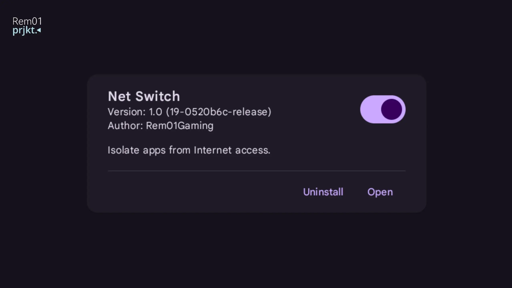
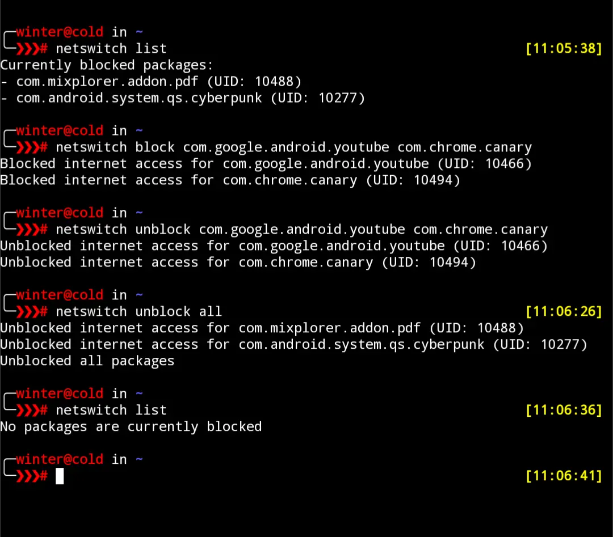

# Net Switch: Isolate Apps from Internet Access


Net Switch is a Magisk module to isolate apps from accessing the internet on your Android device. This tool gives you complete control over which apps can send or receive data, improving security, privacy, and saving bandwidth.

Fully standalone, operates fully on iptables.

## Features
- Per-app internet isolation setting
- Operates without VPN (unlike AFWall)
- Don't suck on battery
- Module WebUI for easy configuration
- **Profiles**: Save and restore sets of isolated apps (new in v1.3)
- **Backup Manager**: Save and restore created profiles (new in v1.3)
- Simple app list with an independent switch for each Android user

## Supported Root Managers
- [APatch](https://github.com/bmax121/APatch) 
- [KernelSU](https://github.com/tiann/KernelSU)
- [Magisk](https://github.com/topjohnwu/Magisk)  <sup>([no WebUI](https://github.com/topjohnwu/Magisk/issues/8609#event-15568590949)👀)</sup>

### WebUI on Magisk
Magisk doesn't support module WebUI on their manager, but you can use one of these apps to open Net Switch WebUI.

- [KsuWebUI](https://github.com/5ec1cff/KsuWebUIStandalone)
- [MMRL](https://github.com/DerGoogler/MMRL)   <sup>👍</sup>

## Usage (WebUI)
- Flash Net Switch Module
- Reboot
- Open Net Switch WebUI
- Select apps you wish to isolate. Changes are applied immediately, no need to reboot.
- (v1.3) Create and apply **profiles** to quickly switch isolation states.
- (v1.3) Backup and restore your profiles.

## Terminal Usage
Open Termux or any terminal with root access and run:
```bash
netswitch block <package>      # block packages
netswitch unblock <package>    # unblock packages
netswitch list                 # show currently blocked packages
netswitch unblock all          # unblock all restricted packages
````

Terminal Screenshot


## Android users and profiles

Each WebUI row identifies its Android user next to the package name (for example,
`User 10 · com.example.app`). Each switch manages that instance independently.
The same package can be isolated in a work profile and allowed in user 0.
The list includes stopped users and paused profiles. **Isolate in all
existing users** selects the currently installed instances; each remains
independently editable. It does not automatically select future users.

The WebUI uses the simple v1.2 list layout and defaults to English. Other
languages remain available through **Select Language**. Saved profiles and the
backup manager are retained under the collapsed **Profile Management** section.

```sh
netswitch block --user 10 com.example.app
netswitch unblock --user 10 com.example.app
netswitch block --all-users com.example.app
netswitch apply       # refresh installed UIDs and reconcile both address families
netswitch clear       # remove module rules, keep saved selections
```

Commands without a user option still target **user 0**. `unblock all` clears all
users' selections. Existing `isolated.json` entries and saved profiles remain
valid: `"com.example.app"` means user 0; `"10:com.example.app"` means user 10.
Profile export/import preserves these entries. Older versions do not understand
the scoped entries; keep a backup before downgrading.

The firewall works on **full UIDs, not individual package names**. Packages with
the same UID cannot be isolated independently. The WebUI shows affected packages
and distinguishes a selected app from one isolated through a shared UID. CLI
commands report the same scope and require `--allow-shared-uid` for new selections
of shared/system UIDs. System UIDs (especially appId 1000) can also own services
not represented by the listed packages. Removing one selection keeps the UID
blocked while another selection still needs it.

### Refresh and failure handling

WebUI changes, profile application, CLI changes and the boot service use the same
`netswitch` backend. It enumerates users with `pm list users`, queries installed
packages and their actual full UIDs using `pm list packages -U --user ID`, and
matches package names exactly. Opening the WebUI reads state without reapplying a
saved profile. No polling service or package/user event listener is installed.

After installing/uninstalling apps or changing Android users, use **Refresh
rules** or `netswitch apply`. A refresh removes stale UID rules and resolves
reinstalled packages again. Missing packages/users retain their saved selections
but have no desired UID rule. Remove unwanted entries explicitly; Android user ID
reuse can make a retained entry apply to a new user with that ID. Existing
selections follow UID changes; shared/system UID scope is reported on each apply,
and the WebUI asks for confirmation when manually refreshing such selections.

User/package query failures, malformed responses and empty per-user package
responses abort without changing rules. This conservatively includes users whose
package inventory is not ready yet. Retry when PackageManager is available;
`netswitch clear` and `netswitch unblock all` can revoke module rules without it.
The boot service still waits for `sys.boot_completed`: this change does **not**
close the boot-time networking window. Boot errors are written to the kernel log;
there is no continuous retry or guarantee of coverage before the next refresh.

Rules live in the reserved `NETSWITCH` filter chain with a tagged OUTPUT jump.
Updates add missing rules before deleting obsolete rules and do not flush OUTPUT
or touch other firewalls. A directory lock serializes writers. IPv4 and IPv6 are
not an atomic transaction: on failure the backend attempts to restore both
previous UID sets and leaves the saved configuration unchanged. A failed rollback
returns exit code 2 and reports incomplete state; inspect `netswitch list` and
retry `apply` or `clear`. Forced termination/power loss can interrupt an update.
A lock left by SIGKILL must only be removed after verifying no backend process is
running; the default lock `/dev/.net-switch-lock` is cleared by reboot.

**Upgrade boundary:** older releases installed untagged rules directly in OUTPUT.
They cannot be distinguished reliably from another firewall's identical rules,
so this version does not delete them. Reboot after updating to start with the new
module-owned rules. WebUI state describes only the new module rules, not legacy
rules or restrictions imposed by other software.

### Development checks

The tests use synthetic Android command output and a firewall model; they do not
connect to a device or modify the host firewall.

```sh
python -m unittest discover -s tests -v
node --test tests/test_webui.mjs
cd webui && npm ci && npm run build
```

On Windows, set `NETSWITCH_TEST_SHELL` to a POSIX shell such as Git for Windows
`sh.exe`. Passing these tests does not replace testing on Android/root managers.

## Changelog

* **v1.3** — Added profiles system, backup manager, and revamped WebUI

## Links

* Download [here](https://github.com/Rem01Gaming/net-switch/releases)
* [Telegram Channel](https://t.me/rem01schannel)

## Help and Support

Report [here](https://github.com/Rem01Gaming/net-switch/issues) if you encounter any issues.

[Pull requests](https://github.com/Rem01Gaming/net-switch/pulls) are always welcome.
UX/UI: [Antonio Riccio](https://github.com/Antonio-Riccio)
